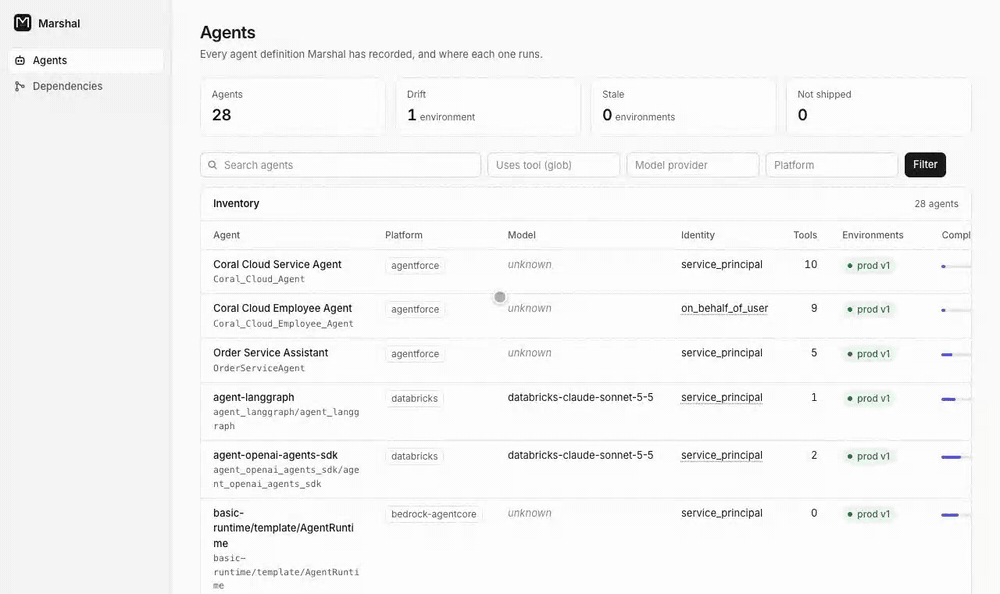

# Marshal — an agent ledger

[](https://pypi.org/project/marshal-ledger/)
[](https://pypi.org/project/marshal-ledger/)
[](https://github.com/marshal-ledger/marshal/actions/workflows/test.yml)
[](LICENSE)

An open-source AI agent inventory for the enterprise: one versioned record of every agent on Copilot Studio, Agentforce, Bedrock, Databricks and agent code, with risk-ranked diffs, drift, dependencies and audit evidence. Any format in, any format out. It runs inside your network, uses no AI and needs no platform credentials.

**[Live demo](https://marshal-ledger.github.io/marshal/demo/)** · **[Documentation](https://marshal-ledger.github.io/marshal/)** · **[Getting started](docs/getting-started.md)**

Marshal reads the agent definitions teams already produce: Databricks bundles, Copilot Studio agents, Bedrock templates, Agentforce metadata, agent code and the open standards. It builds a normalized, versioned record of every agent: what model it asks for, what tools and data it can reach, and who it acts as. Every field says where its value came from, and nothing is guessed.



**Status:** alpha. Before 1.0 a minor release may change the ledger model, the ingest API or the command line; the [changelog](CHANGELOG.md) lists each such change.

## What it does

- **Inventory** of every agent across platforms, with versions, deployments, and each record's completeness.
- **Risk-ranked review:** pull requests that change an agent get a comment that lists permission escalations, new write tools and removed guardrails first.
- **Drift and freshness:** compares what is live with what was shipped, and shows how recently each record was confirmed and by which channel.
- **Dependencies:** "who uses this tool, this knowledge source, this permission?" Refs on other platforms that reach the same HTTP operation, MCP server, knowledge URL or API host are listed too, each with how it matched.
- **Translation** between formats, with a fidelity report computed by reading the result back.
- **Portability scores** for moving an agent to another platform, from a community-maintained capability matrix.

## Easy to approve

Most tools that touch AI agents raise questions in a security review. Marshal is built so it doesn't:

- **It runs inside your network.** You host it, on your own database. There is no Marshal cloud service, so the agent definitions, instructions and permissions it records never go to a vendor. The service's only outbound requests fetch your CI provider's public signing keys.
- **It uses no AI.** Marshal reads definitions with ordinary parsers and fixed, documented rules. It never sends your agents' instructions, tools or permissions to a language model, so there is no AI system to evaluate before you approve it.
- **It needs no platform credentials.** Your existing CI pipelines push definitions to Marshal, signed in with their own short-lived OIDC tokens. Marshal never connects to Copilot Studio, Bedrock or any other platform where your agents live, so it holds no keys to them.

The [security review](docs/security-review.md) covers what Marshal stores, what it connects to, and how releases are signed.

## How it runs



Pipelines you already run record each agent: a pull request records the proposed definition and gets a comment ranking its changes, a deploy records what was shipped, and an optional scheduled export records what is live in a web designer. See the [GitHub Action](docs/github-action.md), [GitLab CI](docs/gitlab-ci.md), [Jenkins and Azure DevOps](docs/other-ci.md) and [Deployment](docs/deployment.md).

## Formats

| Source | Read | Write | Writer tested by |
|---|---|---|---|
| Databricks Asset Bundles (Genie spaces, agent apps) | ✓ | |  |
| AWS CloudFormation and CDK (Bedrock Agents, AgentCore harnesses and runtimes) | ✓ | Bedrock Agents, AgentCore harness | cfn-lint; Bedrock Agents deployed |
| Terraform plan and state (Bedrock Agents, AgentCore harnesses and runtimes; AWS and Cloud Control providers) | ✓ | | |
| AgentCore CLI projects (AgentCore harnesses) | ✓ | | |
| Microsoft Copilot Studio (agent workspaces, solutions) | ✓ | ✓ | published schema, partly |
| Salesforce Agentforce (Agent Script, legacy metadata) | ✓ | Agent Script | round trip |
| Google ADK Agent Config | ✓ | ✓ | published schema; loads in ADK |
| Vertex AI Agent Engine (saved API responses) | inventory | |  |
| Python agent code (OpenAI Agents SDK, LangChain/LangGraph, Google ADK, CrewAI, direct model API calls) | ✓ | |  |
| ADL, Open Agent Spec, AGNTCY OASF | ✓ | ✓ | round trip; published schema for ADL and Agent Spec |
| Marshal file: a hand-written definition for agents no reader covers, recorded as attested | ✓ | ✓ | round trip |

Readers are tested against real, public definitions, pinned to a commit. Only the Bedrock writer's output has been deployed to its platform so far; see [how each format is verified](docs/design.md#formats-and-how-each-is-verified), and [supported versions](docs/formats/supported-versions.md) for the variants each reader handles.

## Try it

Browse the [live demo](https://marshal-ledger.github.io/marshal/demo/), or build it yourself from 29 public agents, with nothing to install but [uv](https://docs.astral.sh/uv/):

```console
$ uvx --from 'marshal-ledger[server]' marshal demo
$ uvx --from 'marshal-ledger[server]' marshal web --db demo.sqlite
```

Or `pip install 'marshal-ledger[server]'`, then `marshal demo` and `marshal web --db demo.sqlite`. `marshal demo` downloads the agents' definitions from their public GitHub repositories, pinned to a commit.

Then on your own agents. See [Getting started](docs/getting-started.md):

```console
$ marshal read path/to/bundle                        # print ledger records
$ marshal collect path/to/bundle --target prod --event shipped
$ marshal ls                                         # every agent, latest version, where it is shipped
$ marshal diff my-team/my_agent                      # proposed against shipped, ranked by risk
$ marshal status my-team/my_agent                    # shipped vs live per environment, drift, freshness
$ marshal deps "*my_tool" --shipped                  # who depends on this, and where it is live
$ marshal convert agent.adl.yaml --to agent-spec     # translate, with a fidelity report
$ marshal port my-team/my_agent --to all             # portability to every platform
$ marshal web                                        # browse the store
```

`collect` writes to a local SQLite store (`marshal.sqlite`, or `--db` / `$MARSHAL_DB`). In a shared deployment, pipelines run `marshal push`, the [GitHub Action](docs/github-action.md) or the [GitLab CI template](docs/gitlab-ci.md) against the [ingest API](docs/ingest-server.md). Optional [scheduled workflows](examples/scheduled/) export agents built in a web designer, such as Copilot Studio and Agentforce, and report drift from what was shipped.

## Documentation

The documentation is published at [marshal-ledger.github.io/marshal](https://marshal-ledger.github.io/marshal/).

- [Getting started](docs/getting-started.md)
- Guides: [Copilot Studio inventory](docs/guides/copilot-studio-inventory.md), [pull request review](docs/guides/pull-request-review.md), [agents in code](docs/guides/agents-in-code.md), [drift](docs/guides/drift-detection.md), [ADK to Agent Spec](docs/guides/convert-adk-to-agent-spec.md), [Bedrock Agents to AgentCore](docs/guides/bedrock-agents-to-agentcore.md), [audit evidence](docs/guides/audit-evidence.md)
- [How Marshal compares](docs/comparison.md) with cloud agent registries, platform admin tools, observability, AI gateways and governance platforms
- [Design](docs/design.md): the problem, architecture, security and network posture, roadmap
- [Ledger model v0](docs/ledger-model.md): records, provenance, version hashing, the version store, risk ranking, freshness
- [Conversion and fidelity](docs/conversion.md) and [Portability](docs/portability.md)
- Formats: [Databricks](docs/formats/databricks.md), [CloudFormation](docs/formats/cloudformation.md), [Terraform](docs/formats/terraform.md), [AgentCore CLI](docs/formats/agentcore-cli.md), [Copilot Studio](docs/formats/copilot-studio.md), [Agentforce](docs/formats/agentforce.md), [ADK Agent Config](docs/formats/adk-config.md), [Vertex AI Agent Engine](docs/formats/vertex-agent-engine.md), [Python agent code](docs/formats/python.md), [ADL](docs/formats/adl.md), [Agent Spec](docs/formats/agent-spec.md), [OASF](docs/formats/oasf.md), [Marshal file](docs/formats/marshal-file.md)
- [Platform exportability](docs/platform-exportability.md): what each closed platform exposes
- [Ingest API](docs/ingest-server.md), [GitHub Action](docs/github-action.md), [GitLab CI](docs/gitlab-ci.md), [Jenkins and Azure DevOps](docs/other-ci.md) and [Deployment](docs/deployment.md)
- [Security review](docs/security-review.md): what is stored, authentication, network, supply chain, retention and audit, for security reviewers

## Development

```console
$ pip install -e '.[dev]'
$ python scripts/fetch_fixtures.py     # golden fixtures: real public agent definitions, pinned by commit
$ pytest
```

See [Contributing](CONTRIBUTING.md). Golden fixtures are fetched rather than committed, so each file stays under its upstream license. After changing the model, regenerate the schema with `python scripts/generate_schema.py`. Report vulnerabilities as described in [Security](SECURITY.md).

## License

Marshal is licensed under the [Apache License 2.0](LICENSE).
